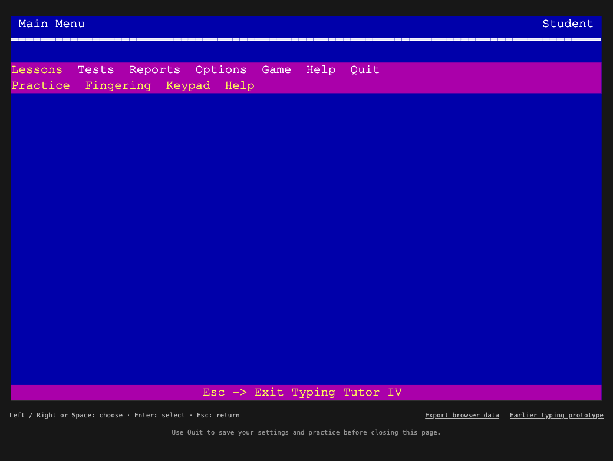

# Typing Tutor IV Remake

An open-source browser remake of the DOS programme. The current delivery recreates the **original menus, settings, practice screen/scoring, full-keyboard teaching, fingering review, keypad lessons/tests, Disk tests, reports and Letter Invaders** using recovered REA/Ghidra evidence.

First public release: **v0.2.0**. This is a JavaScript reconstruction; the original DOS executable is not run or bundled.



Live app: **https://tt.xcstudio.dev** — hosted on GitHub Pages with automatic deployment from main and HTTPS enforced.
New implementation code is MIT licensed; [license scope](COPYING.md) and [original-resource provenance](THIRD_PARTY.md) identify the historical content separately.

## Run

Requires Python 3 and a current browser. Google Chrome is verified; Safari has not been verified yet.

```sh
git clone https://github.com/xichuanxc/typing-tutor-remake.git
cd typing-tutor-remake
python3 scripts/serve.py
```

Open http://127.0.0.1:8080. Stop the server with Ctrl+C.
After downloading the repository, no dependency installation, build step, account or internet connection is needed to run the supplied app.
Python only serves static files on your computer. All application logic runs in the browser; progress is saved in that browser's localStorage.
Use the same browser and address to return to saved progress. Direct file:// opening is not supported because the app uses JavaScript modules.
Use Export browser data for a JSON backup; backup import is not implemented yet.

A browser with no saved user data shows the recovered welcome animation and music. Press a key or click its prompt to start; Escape skips. Saved profiles open directly at the main menu. To try it without changing your progress, use a fresh Chrome Incognito session. See [startup behavior and original TT.HIS findings](docs/startup-welcome.md).

## Current delivery: original typing loop and Letter Invaders

- First-user welcome with original simulated title typing, keyboard highlights, animated logo and64-note startup music.
- Fixed 80×25 character screen, original menu positions, colors, header/footer and idle instructions.
- All six student menus: Main, Lessons, Tests, Reports, Options and Game.
- Options: original WPM tiers, weekly hours, 5/10/15/20 drills, sound, name, Intro and Help.
- Original HLP content, independently verified earlier Intro text, and home-key placeholder substitutions.
- Lessons → Practice: original exercise/focus/results boxes, error arrows, correction and end-of-lesson summary.
- Recovered integer scoring with separate final accuracy and per-key attempt records.
- Adaptive drills through all 64 original keyboard entries, original word lists, reach tutorials and Shift.
- Original focus-key and lesson-summary rankings driven by individual key performance.
- Fingering review with immediate, unscored reach drills and original keyboard highlights.
- Adaptive keypad lessons, nine-entry reach warmups and 24-entry keypad tests with separate per-key/report counters.
- Original Disk tests from local .tst/.txt files, including six-line paging, byte decoding and separate test history.
- Six-line Practice/All-keys tests with the recovered full-key text generator and result dialog.
- Progress, Speed and Accuracy reports with current/history counters and original graph layout.
- Letter Invaders: Practice Keys/Full Keyboard, one/two players, original targeting/scoring, all five recovered gameplay sound cues and separate global top-five tables.
- Working settings, practice records and game scores remain in memory. Use **Quit → Yes, save session to history** to persist them.
- Quit → No discards changes; Return to Main Menu keeps the session open.
- Export browser data downloads both saved versions and the current working session.

Menus use Left/Right or Space, Enter, Escape and first-letter shortcuts.
Choice dialogs use Up/Down or Space and Enter. Mouse selection and Tab/Enter are also supported.
Use a physical keyboard; the scaled narrow-window layout is not a touch typing interface.

The native DOS font, sound waveform and all runtime behavior are not yet fully matched.
Practice now follows the original curriculum through punctuation, digits and symbols, including the embedded word lists and grammar. Reach drills accept typing immediately. Fingering review and numeric keypad lessons/tests are also delivered. Disk tests and Letter Invaders are also delivered. See [Letter Invaders](docs/letter-invaders.md) for controls, scoring, evidence and limits.
Choose Tests → Disk, then Choose local test files below the screen. See [Disk tests](docs/disk-tests.md) for original byte handling and browser limits.
See [fingering and keypad](docs/fingering-and-keypad.md) for the current delivery.
See [the full keyboard delivery](docs/full-keyboard-curriculum.md) for the current scope.
Reports cycle with any ordinary key; Escape returns to Main Menu. See [tests and reports](docs/tests-and-reports.md) for evidence and limits.
See [the adaptive curriculum delivery](docs/adaptive-curriculum.md) for evidence, compatibility and remaining limits.

Keypad entries accept Plus, Enter or Space to finish a number; digit keys and the numeric keypad both work.
Practice uses printable keys, Backspace and Enter/Space to finish a line. Escape returns to Main Menu.
Corrected mistakes disappear from final accuracy while timed attempts remain recorded. Inactivity counts; there is no automatic pause.
See [the scoring contract and fidelity record](docs/practice-scoring.md) for the recovered rules and current limits.

## Package for online hosting

~~~sh
npm run package:web
~~~

Upload the extracted contents of artifacts/typing-tutor-remake-v0.2.0-web.zip to an HTTPS static host. No Python or backend is needed online. See [deployment and the proposed domain](docs/deployment.md) for checksums, automatic GitHub Pages deployment, DNS and browser-storage details.

## Earlier playable prototype

The v0.1 typing app is retained in dist/prototype/ for reference and local testing at http://127.0.0.1:8080/prototype/.
It is excluded from the online site and deployment ZIP. Its old lessons, reports and scoring remain available in the repository.
Its original browser-storage key is untouched. The faithful app uses a separate versioned key; no scores are migrated or relabeled.

## Checks

```sh
npm test
python3 scripts/verify-tt-analysis.py
```

Chrome browser checks require the project-local dev dependency and installed Google Chrome:

```sh
npm ci
npm run test:browser
npm run test:practice
npm run test:adaptive
npm run test:prototype
npm run test:reports
npm run test:keypad
npm run test:disk
npm run test:invaders
npm run test:audio
```

The tests use temporary profiles, start/stop their own loopback servers and capture screenshots under docs/screenshots/.
The server exposes only dist/; DOS references and analysis artifacts are outside its web root.

## Records

- [Process log](PROCESS.md)
- [F5c Letter Invaders and global scores](docs/letter-invaders.md)
- [F5b Disk tests](docs/disk-tests.md)
- [F5a fingering and keypad](docs/fingering-and-keypad.md)
- [F4c full keyboard lessons](docs/full-keyboard-curriculum.md)
- [F4b tests and reports](docs/tests-and-reports.md)
- [F4a adaptive curriculum](docs/adaptive-curriculum.md)
- [F3 practice/scoring delivery](docs/practice-scoring.md)
- [Practice screenshot](docs/screenshots/faithful-practice.png)
- [F1/F2 delivery and fidelity matrix](docs/faithful-delivery.md)
- [Current screenshot](docs/screenshots/faithful-main-menu.png)
- [WPM dialog screenshot](docs/screenshots/faithful-wpm-dialog.png)
- [Original settings audit](docs/original-settings.md)
- [Next-stage plan](docs/next-steps.md)
- [REA reverse-engineering report](docs/reverse-engineering.md)
- [Original reference findings](docs/original-program.md)

Generated browser resources are included, so the app and unit tests do not require the DOS files.
The original TT.EXE, TT.HLP and TT.HIS and the local tool installations are excluded from this public repository.
Historical receipts refer to these locally preserved files; they are evidence records, not a list of files bundled in the release.
With separately supplied local references, verify them using python3 scripts/verify-originals.py.
See [resource provenance](THIRD_PARTY.md) and [the first public release](docs/releases/v0.2.0.md).

Resource regeneration additionally requires the original references and unpacked analysis copy described in [the analysis guide](analysis/README.md):

```sh
python3 scripts/build-faithful-resources.py
python3 scripts/extract-curriculum-data.py
python3 scripts/extract-report-data.py
python3 scripts/extract-keypad-data.py
python3 scripts/extract-disk-data.py
python3 scripts/extract-invaders-data.py
```

Running the app does not require REA or Ghidra.

The original DOS files remain subject to their original rights. They are reference material;
this project does not establish permission to redistribute them.
